
**Des onglets qui dorment, des pages ouvertes en double, des pubs qui alourdissent tout : ChromeOptimizer s'en occupe, sans ralentir Chrome lui-même.**

[Site](https://chpalitom09-bot.github.io/ChromeOptimizer/) · [Benchmark](https://chpalitom09-bot.github.io/ChromeOptimizer/benchmark.html) · [Nouveautés](#nouveautés-de-la-13) · [Fonctionnalités](#fonctionnalités) · [PULSA 2](#pulsa-2-et-le-cerveau) · [Outils](#outils-pubs-préchargement-vidéos) · [AO1](#ao1-bêta) · [Benchmark](#benchmark) · [Versions](#versions) · [Installation](#installation) · [Réglages](#réglages) · [Vie privée](#vie-privée)


> **Version 1.3 (r19), sur le Chrome Web Store.** Les mesures de performance sont publiques : méthode, courbes et données brutes sont sur la [page du benchmark](https://chpalitom09-bot.github.io/ChromeOptimizer/benchmark.html). **1PW**, **AO1** et **BSWP** restent en **bêta** ou **expérimental**.


*Aperçu illustratif : les valeurs affichées sont des exemples. Les vraies mesures sont dans la section [Benchmark](#benchmark).*

## C'est quoi, ChromeOptimizer ?

ChromeOptimizer est un **panneau d'optimisation pour Chrome**. Il repère les onglets que vous n'avez pas touchés depuis longtemps et les met en veille, trouve les pages ouvertes plusieurs fois et n'en garde qu'une, bloque les publicités et les traceurs qui alourdissent les pages, puis vous montre ce que ça a libéré. Quand un onglet doit passer avant tous les autres, **1PW** met le reste en veille d'un clic.

Pas de compte, pas de pub, pas de collecte de données. Tout se passe dans votre navigateur.


## Nouveautés de la 1.3

| Nouveauté | Ce que ça apporte |
| --------- | ----------------- |
| **PULSA 2 et le cerveau** | Il prédit dans combien de temps vous revenez sur un onglet, le met en veille, puis le recharge juste avant votre retour. Un petit réseau de neurones apprend vos habitudes, uniquement sur votre ordinateur |
| **Bloqueur de pubs et de traceurs** | Des règles de blocage réseau, plus le masquage des emplacements publicitaires restants. Une liste de sites autorisés permet de faire des exceptions |
| **Préchargement au survol** | La page visée commence à se charger quand le pointeur reste sur un lien : au clic, elle s'affiche presque instantanément |
| **Vidéos hors écran** | Les vidéos muettes qui tournent en boucle hors de l'écran sont mises en pause, puis relancées quand elles reviennent |
| **AO1 (bêta)** | Analyse les fichiers téléchargés pour repérer les signaux suspects, avec une note de A+ à F |
| **Interrupteur général** | Un bouton dans le panneau met toute l'extension en pause d'un coup. Vos réglages sont conservés |
| **Écran de bienvenue** | Au premier lancement : langue, profil (prudent, équilibré, performance), choix de PULSA, modules |
| **16 langues** | Français, anglais, espagnol, allemand, italien, portugais, polonais, turc, russe, chinois, japonais, coréen, arabe, hindi, bengali et indonésien |
| **Thèmes** | Automatique, clair, sombre, bleu, graphite, vert, rose, avec couleur d'accent et arrondis réglables |
| **Benchmark public** | Un script reproductible et une page de résultats, voir [Benchmark](#benchmark) |


## Fonctionnalités


| Et aussi                   | Détail                                                                                                  |
| -------------------------- | ------------------------------------------------------------------------------------------------------- |
| **Panneau d'optimisation** | Liste des onglets avec leur état : actif, inactif, doublon                                              |
| **Optimiser en un clic**   | Ou automatiquement, selon le mode choisi dans les réglages                                              |
| **PULSA 2**                | Prédiction du retour sur chaque onglet, avec rechargement juste avant                                   |
| **1PW** *(bêta)*           | Met tous les autres onglets en veille pour concentrer Chrome sur un seul, par exemple un jeu            |
| **Module Safe**            | Ne met jamais en veille un onglet en appel ou avec du son (activé par défaut)                           |
| **Outils**                 | Bloqueur de pubs, préchargement au survol, vidéos hors écran                                            |
| **AO1** *(bêta)*           | Analyse des fichiers téléchargés                                                                        |
| **BSWP**                   | Charge d'abord ce qui est visible : les images et vidéos très loin sous l'écran attendent               |
| **EcoOptimizer**           | Espace les vérifications et met des fonctions en pause quand la batterie baisse                         |
| **Seize langues**          | Interface complète, y compris l'écran de bienvenue                                                      |
| **Mises à jour**           | Une pastille et une bannière préviennent d'une nouvelle version ou d'une correction                     |
| **Sites protégés**         | Une liste de sites que l'extension ne touche jamais                                                     |
| **Raccourcis clavier**     | `Alt + Maj + P` (PULSA), `Alt + Maj + O` (optimiser) et `Alt + Maj + 1` (1PW)                           |
| **Compteurs locaux**       | Onglets mis en veille et doublons fermés, gardés sur votre machine                                      |


## PULSA 2 et le cerveau

**PULSA** (*Predictive Usage Scoring and Lifecycle Algorithm*) remplace le délai fixe par une prédiction. La version 2 va plus loin que la première : elle estime **dans combien de temps** vous reviendrez sur un onglet, puis le recharge juste avant ce moment.

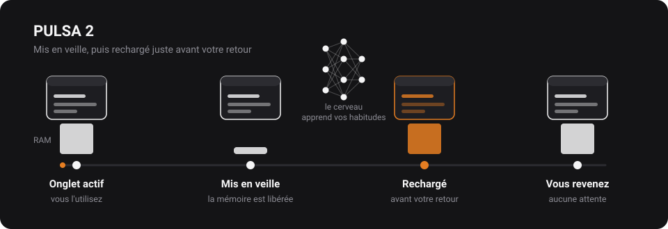

| Principe                         | Ce que ça change                                                                                                                                              |
| -------------------------------- | ------------------------------------------------------------------------------------------------------------------------------------------------------------- |
| **Un score, pas un chronomètre** | De 0 à 100. Plus il est bas, moins l'onglet a de chances d'être rouvert. Sous le seuil du profil choisi (prudent, équilibré ou performance), il est mis en veille |
| **Le cerveau**                   | Un petit réseau de neurones de 296 paramètres apprend votre heure de la journée, vos enchaînements d'onglets et vos habitudes pour viser le bon moment de rechargement |
| **Rechargé avant votre retour**  | Quand le cerveau est assez sûr de lui, l'onglet est déjà chargé quand vous revenez : aucune attente                                                           |
| **Il corrige ses erreurs**       | Si un onglet endormi est rouvert trop vite, PULSA devient plus prudent pour ce site                                                                           |
| **Il adapte son seuil**          | Prudent tant que la mémoire est libre, plus ferme quand elle manque, et réglé tout seul selon les onglets rouverts trop vite                                  |
| **Hors ligne, il se retient**    | Il évite de recharger un onglet quand le réseau est absent ou très lent                                                                                       |
| **Léger**                        | Un calcul simple, sans réseau, et des cycles qui s'espacent quand il n'y a rien à faire                                                                       |
| **Désactivable**                 | On peut revenir à PULSA 1 ou au délai fixe, et un bouton efface ce que le cerveau a appris                                                                    |

**Ce que PULSA garde.** Uniquement le **nom de domaine** des sites et des **durées**, sur votre ordinateur. Jamais le contenu des pages ni leur adresse complète, et rien n'est envoyé.


## 1PW (bêta)

**1PW** (*One Page Web*) sert quand un onglet doit passer avant les autres : un jeu de navigateur qui rame, par exemple. Vous l'activez depuis cet onglet, et l'extension met **tous les autres en veille** pour libérer de la mémoire et du processeur.


| Principe                              | Ce que ça change                                                                                                         |
| ------------------------------------- | ------------------------------------------------------------------------------------------------------------------------ |
| **Un interrupteur ou un raccourci**   | Cochez **1PW** dans le panneau depuis l'onglet à privilégier, ou appuyez sur `Alt + Maj + 1` (modifiable dans `chrome://extensions/shortcuts`) |
| **Les autres onglets dorment**        | Mise en veille native de Chrome (`chrome.tabs.discard`) : les onglets restent dans la barre et se rechargent au clic     |
| **Les nouveaux onglets aussi**        | Tant que le mode est actif, un onglet ouvert en arrière-plan est endormi dès qu'il a fini de charger                     |
| **Les mêmes protections**             | Onglet visible, onglets épinglés, sites protégés, pages internes de Chrome, et (module Safe) onglets en appel ou avec du son sont épargnés |
| **Il s'arrête tout seul**             | Quand vous le décochez, ou quand vous fermez l'onglet du jeu. Une pastille verte **1PW** sur l'icône indique qu'il est actif |
| **Fenêtre de l'onglet seulement**     | Une option des réglages laisse éveillés les onglets des autres fenêtres Chrome                                           |

> [!WARNING]
> **1PW est en bêta.** Un onglet en veille perd son état : ce qui n'y a pas été enregistré (un formulaire à moitié rempli, par exemple) est perdu. Chrome ne permet pas de donner plus de puissance à un onglet : 1PW **retire seulement de la charge ailleurs**. Si le ralentissement vient du jeu lui-même ou de la carte graphique, le gain sera faible. 1PW n'est pas mesuré à part par le benchmark.


## Module Safe

Le module **Safe** garde éveillés les onglets qu'il serait gênant d'endormir. Il est **activé par défaut** et s'applique à PULSA, au mode classique et à 1PW.

| Ce qui est protégé                  | Comment c'est reconnu                                                                                             |
| ----------------------------------- | ----------------------------------------------------------------------------------------------------------------- |
| **Un onglet qui joue du son**       | L'état « son en cours » fourni par Chrome (`tab.audible`)                                                         |
| **Un onglet qui en a joué récemment** | Le service worker note l'heure du dernier changement sonore (en session) : moins de 5 minutes, il reste éveillé |
| **Un onglet de visioconférence**    | Son adresse seulement : Google Meet et Voice, Zoom dans le navigateur, Microsoft Teams, Whereby, Webex, Jitsi, Skype, BlueJeans, GoToMeeting, Around |

Pour un service qui n'est pas dans la liste, ajoutez son site aux **sites protégés**. Le module s'éteint d'un interrupteur dans le panneau ou dans les réglages.

> [!NOTE]
> Safe ne lit aucune page : il ne regarde que l'adresse et l'état sonore que Chrome fournit déjà. Chrome n'indique pas si un onglet utilise le micro ou la caméra : un appel dans un service inconnu et silencieux n'est donc reconnu que par ses 5 minutes de grâce, ou par la liste des sites protégés.


## Outils : pubs, préchargement, vidéos

Trois outils s'ajoutent aux onglets en veille. Chacun a son interrupteur dans les réglages, et le bloqueur de pubs accepte une liste de sites autorisés.


| Outil                       | Ce qu'il fait                                                                                                                                                                  |
| --------------------------- | ------------------------------------------------------------------------------------------------------------------------------------------------------------------------------ |
| **Bloqueur de pubs**        | Des règles de blocage réseau (`declarativeNetRequest`) coupent les requêtes vers les domaines de publicité et de traçage. Moins de requêtes, des pages plus légères, moins de mémoire. Les règles s'appuient sur EasyList, voir `rules/LICENSE-EASYLIST.txt` |
| **Masquage cosmétique**     | Cache les emplacements publicitaires qui subsistent dans la page                                                                                                               |
| **Préchargement au survol** | Quand le pointeur reste environ 65 ms sur un lien, la page visée commence à se charger. Même site seulement, jamais de lien de déconnexion, de panier ou de fichier, rien en économie de données ou en 2G, 25 pages au maximum par onglet |
| **Vidéos hors écran**       | Met en pause les vidéos **sans son** qui tournent hors de l'écran, puis les relance quand elles reviennent. Une vidéo avec du son, en image dans l'image ou branchée sur une caméra n'est jamais touchée |

> [!NOTE]
> Les outils qui agissent dans les pages demandent à Chrome l'**accès aux sites**, une permission optionnelle. Aucun de ces scripts ne lit ni n'envoie quoi que ce soit.


## AO1 (bêta)

**AO1** analyse les fichiers que vous téléchargez et repère les signaux suspects : noms qui imitent une facture ou un devis, extensions exécutables, hébergeurs de fichiers éphémères, domaines à terminaison douteuse, entre autres. Il attribue une note, **de A+ (sain) à F (menace critique)**, et vous prévient par notification.

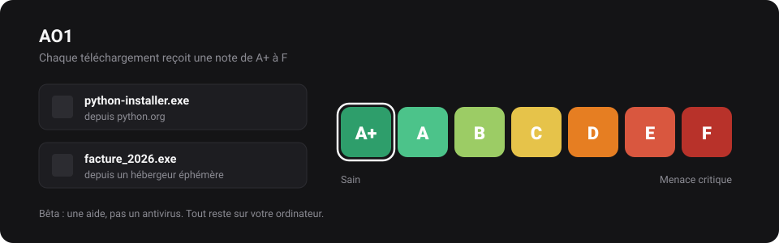

| Principe                       | Ce que ça change                                                                                                  |
| ------------------------------ | ----------------------------------------------------------------------------------------------------------------- |
| **Les preuves comptent plus**  | Un signal « dur » compte en entier. Les simples indices sont plafonnés et ne bloquent seuls qu'en sensibilité maximale, pour éviter les fausses alertes |
| **Trois sensibilités**         | Léger, normal ou poussé                                                                                           |
| **Les éditeurs connus**        | Les signaux souples sont ignorés pour les éditeurs et distributeurs reconnus. Les sites qui hébergent du contenu envoyé par n'importe qui n'en profitent jamais |
| **Local**                      | Tout reste sur cet ordinateur                                                                                     |

> [!WARNING]
> **AO1 est en bêta et ne remplace pas un antivirus.** C'est une aide qui lève un drapeau, pas une garantie : un fichier noté A+ peut malgré tout être dangereux.


## BSWP

**BSWP** (*Better Speed WebPage*) est un petit script qui accélère le chargement des pages en ne chargeant que le nécessaire. Les images, cadres et vidéos situés **loin sous la zone visible** attendent que vous descendiez, et la connexion est libérée pour le haut de la page.


| Principe                                | Ce que ça change                                                                                                           |
| --------------------------------------- | -------------------------------------------------------------------------------------------------------------------------- |
| **Il ne diffère que le lointain**       | Seuls les éléments à plus de deux écrans sous la zone visible sont touchés                                                 |
| **Images et cadres en chargement différé** | Chargement différé natif de Chrome (`loading="lazy"`) et décodage asynchrone                                            |
| **Vidéos : métadonnées seulement**      | Les vidéos sans lecture automatique ne préchargent que leurs métadonnées                                                   |
| **Aucun script bloqué ni retiré**       | Il ne bloque, ne retire et ne reporte aucun script : le risque de casser l'affichage est réduit                            |
| **Éteint par défaut**                   | Il s'active d'un interrupteur dans le panneau                                                                              |

> [!WARNING]
> **BSWP est expérimental** et n'est pas mesuré à part. À l'activation, Chrome vous demande l'accès aux sites. Rechargez les pages déjà ouvertes après l'avoir activé.


## EcoOptimizer

Sur batterie, **EcoOptimizer** adapte le rythme de l'extension au niveau restant : les cycles de vérification s'espacent par paliers, et quelques fonctions annexes se mettent en pause quand la charge devient critique. Il reste **éteint par défaut**.


| Batterie | Cycles plus lents de | Fonctions en pause                                                                  |
| -------- | -------------------- | ----------------------------------------------------------------------------------- |
| ≤ 40 %   | 5 %                  |                                                                                     |
| ≤ 30 %   | 10 %                 |                                                                                     |
| ≤ 20 %   | 15 %                 | Historique des sites                                                                |
| ≤ 10 %   | 30 %                 | Historique des sites, BSWP, lecture de la mémoire, réglage automatique du seuil     |

Branché sur secteur, l'extension retrouve son rythme normal. Une extension ne peut pas lire la batterie depuis son service worker : un document invisible s'en charge, n'existe que si EcoOptimizer est activé, et ne prévient l'extension que lorsque le palier change.


## Benchmark

Un benchmark compare **trois configurations de Chromium** sur exactement le même scénario : Chrome sans rien, Chrome avec l'économiseur de mémoire et d'énergie natif, et Chrome avec ChromeOptimizer.

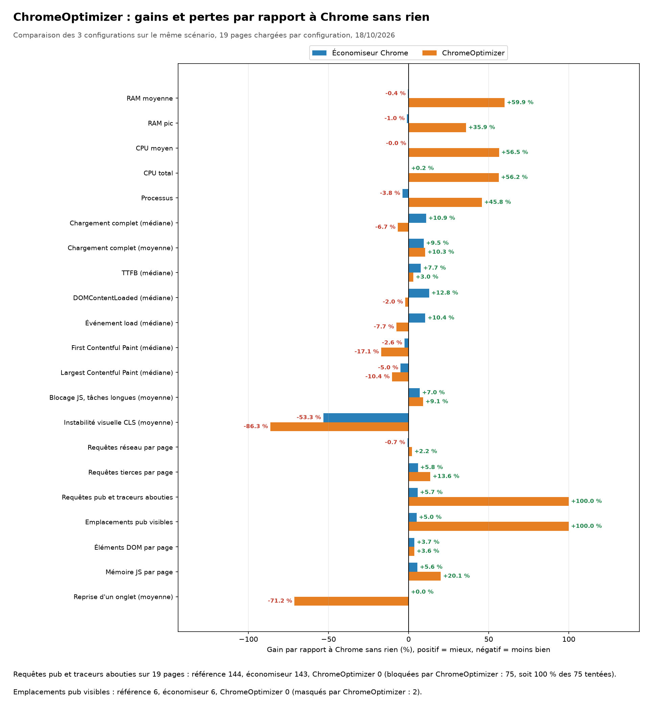

**[Voir tous les résultats, courbes et données brutes](https://chpalitom09-bot.github.io/ChromeOptimizer/benchmark.html)**

Les chiffres ne sont volontairement pas recopiés ici : ils vivent sur la page, qui se met à jour à chaque nouveau benchmark publié dans `benchmarks/`. Les points faibles y figurent aussi.

| Étape du scénario            | Ce qui se passe                                                                                           |
| ---------------------------- | --------------------------------------------------------------------------------------------------------- |
| **Navigation**               | 20 sites ouverts, un par onglet, avec défilement et mouvements de souris naturels, et quelques retours sur d'anciens onglets |
| **Inactivité**               | 6 minutes sur un seul onglet, les autres restent en arrière-plan                                          |
| **Retour sur les onglets**   | Chaque onglet est réactivé dans un ordre aléatoire fixe, avec mesure du délai de reprise                  |
| **Repos final**              | 1 minute sans navigation                                                                                  |

| Ce qui garantit l'équité                | Détail                                                                                                    |
| --------------------------------------- | --------------------------------------------------------------------------------------------------------- |
| **Profil vierge à chaque fois**         | Chaque configuration démarre d'un profil Chromium neuf, avec la même graine aléatoire                      |
| **Horloge accélérée**                   | ChromeOptimizer endort les onglets après 30 minutes d'inactivité. Le test accélère l'horloge interne de l'extension (x6 par défaut) pour simuler ces 30 minutes en 5 minutes réelles. Le code de l'extension n'est pas modifié |
| **Même sonde partout**                  | Les onglets réellement endormis sont lus par la même extension sonde dans les trois cas                    |
| **Mesures**                             | Mémoire privée, working set, CPU et nombre de processus de tout l'arbre du navigateur, toutes les 2 secondes, plus temps de chargement, requêtes, publicités et reprise des onglets |

**Refaire le test chez vous.** Le script `benchmark.py` installe Playwright, lance Chromium trois fois et écrit les résultats dans `resultats/` (graphiques, JSON, PDF).

```
python benchmark.py          # test complet, algorithme classique
python benchmark.py pulsa    # avec PULSA 2
python benchmark.py load     # chargement de pages seulement
python benchmark.py k10      # horloge accélérée x10
```

Placez le zip de l'extension à côté du script. Pour publier un résultat, copiez **tout le contenu** de `resultats/` dans `benchmarks/1/`, `benchmarks/2/`, et ainsi de suite. La page détecte les dossiers toute seule.

> [!NOTE]
> Un benchmark est une mesure sur **une machine et un scénario**. Il montre un ordre de grandeur honnête, pas une promesse pour votre ordinateur. La section Protocole de la page indique le matériel, la version de Chromium et l'algorithme testé.


## Seize langues

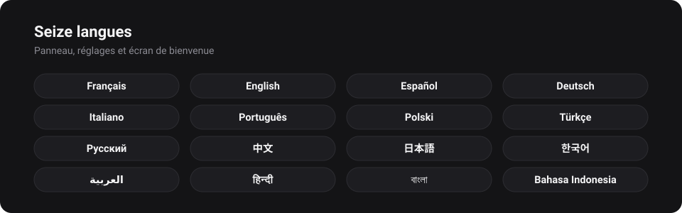

Un bouton avec le drapeau change la langue, dans le panneau comme dans les réglages, avec une recherche. Au premier lancement, l'extension suit la langue du navigateur si elle est disponible, sinon elle s'affiche en anglais. Le nom et la description dans la page des extensions de Chrome suivent, eux, la langue du navigateur.


## Versions

Chaque version est un `.zip` à décompresser puis à charger dans Chrome. Pour mettre à jour : remplacez le dossier, puis cliquez sur **Recharger** sur `chrome://extensions`. Depuis le Chrome Web Store, la mise à jour est automatique.

| Version | Modules | Nouveautés | Téléchargement |
| ------- | ------- | ---------- | -------------- |
| **1.3** (dernière, r19) | PULSA 2, Outils, AO1, 1PW, Safe, BSWP, Eco | PULSA 2 avec cerveau, bloqueur de pubs et de traceurs, préchargement au survol, vidéos hors écran, AO1 (bêta), interrupteur général, écran de bienvenue, 16 langues, thèmes. r19 : nom et description adaptés au Chrome Web Store | [`ChromeOptimizer-v1_3-R19.zip`](ChromeOptimizer-v1_3-R19.zip) |
| **1.1** (r1) | PULSA, BSWP, Eco, 1PW, Safe | **Module Safe** : les onglets en appel ou avec du son ne sont jamais mis en veille. **1PW (bêta)** : tous les autres onglets en veille, raccourci `Alt + Maj + 1`, pastille sur l'icône. Mises à jour via `version.json` | [`ChromeOptimizer-4-v1.1.zip`](ChromeOptimizer-4-v1.1.zip) |
| **1.0** | PULSA, BSWP, Eco | Page des réglages à la façon des Paramètres Windows : catégories, sous-parties, barre de recherche et interrupteurs | [`ChromeOptimizer-pulsa-bswp-eco-v1.0.zip`](ChromeOptimizer-pulsa-bswp-eco-v1.0.zip) |
| **0.9** | PULSA, BSWP, Eco | Quatre nouvelles langues, pluriels gérés pour chacune | [`ChromeOptimizer-pulsa-bswp-eco-v0.9.zip`](ChromeOptimizer-pulsa-bswp-eco-v0.9.zip) |
| **0.8** | PULSA, BSWP, Eco | EcoOptimizer (batterie), interface en français et anglais avec sélecteur à drapeaux | [`ChromeOptimizer-pulsa-bswp-eco-v0.8.zip`](ChromeOptimizer-pulsa-bswp-eco-v0.8.zip) |
| **0.6** | PULSA, BSWP | BSWP : chargement différé des éléments loin sous la zone visible | [`ChromeOptimizer-pulsa-bswp-v0.6.zip`](ChromeOptimizer-pulsa-bswp-v0.6.zip) |
| **0.5** | PULSA | Vérification quotidienne de la dernière version, jauges circulaires mémoire et processeur | [`ChromeOptimizer-pulsa-v0.5.zip`](ChromeOptimizer-pulsa-v0.5.zip) |
| **0.4** | PULSA | Seuil adaptatif selon la pression mémoire, cycles espacés quand il n'y a rien à faire | [`ChromeOptimizer-pulsa-v0.4.zip`](ChromeOptimizer-pulsa-v0.4.zip) |
| **0.3** | PULSA | Interrupteur PULSA dans le panneau, liste des sites visités, raccourcis clavier | [`ChromeOptimizer-pulsa-v0.3.zip`](ChromeOptimizer-pulsa-v0.3.zip) |
| **0.2** | PULSA | Premier algorithme PULSA : score de réutilisation par site, apprentissage des habitudes, banc d'essai sur usages simulés | [`ChromeOptimizer-pulsa-v0.2.zip`](ChromeOptimizer-pulsa-v0.2.zip) |
| **0.1** | Délai fixe | Version de base : mise en veille après un délai d'inactivité, fermeture des doublons, panneau et réglages | [`ChromeOptimizer-extension.zip`](ChromeOptimizer-extension.zip) |

> [!NOTE]
> Le dépôt ne contient que les **zips** : le code de l'extension se trouve dans chacun d'eux. La page [Versions](https://chpalitom09-bot.github.io/ChromeOptimizer/#versions) du site liste aussi toutes les archives.

### Mises à jour et numéros de version

Une fois par jour, l'extension lit le fichier public [`version.json`](version.json) de ce dépôt et le compare à sa propre version. Si une version plus récente existe, une **pastille ↑** apparaît sur l'icône, le panneau affiche une bannière, et les réglages montrent les notes de version. Aucune donnée n'est envoyée, et la vérification se désactive dans les réglages.

Le numéro **affiché** reste celui de la version (`1.3`). Le numéro **technique** compte un quatrième chiffre pour les corrections :

| Ce qui est publié         | Numéro technique (`version`) | Nom affiché (`version_name`) | Vu dans l'extension |
| ------------------------- | ---------------------------- | ---------------------------- | ------------------- |
| 1.3 à sa sortie           | `1.3.0`                      | `1.3`                        | 1.3                 |
| Correction numéro 19      | `1.3.0.19`                   | `1.3`                        | 1.3 r19             |
| 1.4 à sa sortie           | `1.4.0`                      | `1.4`                        | 1.4                 |

Ainsi, quand la 1.3 est corrigée, ses utilisateurs voient quand même la mise à jour.


## Léger par conception

Une extension qui optimise Chrome ne doit pas devenir le problème. Les choix suivants servent à ce qu'elle consomme le moins possible.


| Principe                              | Ce que ça change                                                                                                                  |
| ------------------------------------- | --------------------------------------------------------------------------------------------------------------------------------- |
| **Événements, pas de boucle**         | L'extension écoute `chrome.tabs` et ne scrute rien en continu. 1PW non plus                                                       |
| **Peu d'alarmes**                     | `chrome.alarms` réveille le service worker une fois par minute (jusqu'à 10 minutes quand il n'y a rien à faire), plus une alarme par jour pour la version |
| **Scripts dans les pages sur accord** | Les scripts qui agissent dans les pages (BSWP, outils) ne fonctionnent qu'avec l'accès aux sites que vous accordez                |
| **Blocage sans script**               | Le bloqueur de pubs utilise les règles de blocage de Chrome, qui n'exécutent aucun code dans vos pages                            |
| **Dernier accès fourni par Chrome**   | Chrome expose déjà la date de dernier accès de chaque onglet (`lastAccessed`), inutile de la suivre soi-même                      |
| **Mesures à la demande**              | La mémoire et le processeur ne sont lus que pendant que le panneau est ouvert                                                     |
| **Mode manuel**                       | Si vous le choisissez, aucune alarme de cycle n'existe : rien ne se réveille en arrière-plan pour optimiser                       |
| **Mise en veille native**             | `chrome.tabs.discard` libère la mémoire de l'onglet, qui reste dans la barre et se recharge au clic                               |

Le [benchmark](#benchmark) mesure aussi le coût de l'extension elle-même, puisque sa consommation est comprise dans les résultats de la configuration ChromeOptimizer.


## Installation

### Depuis le Chrome Web Store

Cherchez **ChromeOptimizer** sur le Chrome Web Store, puis cliquez sur **Ajouter à Chrome** et épinglez l'extension depuis l'icône puzzle de la barre d'outils. Chrome 121 ou plus récent est nécessaire.

### À la main, avec le mode développeur

Utile pour tester une version qui n'est pas encore au Web Store. Cela prend **2 minutes**.

**1. Télécharger.** Récupérez [`ChromeOptimizer-v1_3-R19.zip`](ChromeOptimizer-v1_3-R19.zip) (ou une [autre version](#versions)).

**2. Décompresser.** Clic droit sur le `.zip` puis **Extraire tout** (Windows), ou double-clic (Mac).

> [!IMPORTANT]
> Chrome ne sait pas charger un `.zip` directement : il lui faut le **dossier décompressé**. Rangez-le à un endroit où il ne bougera plus (si vous le déplacez ou le supprimez, l'extension disparaît).

**3. Charger dans Chrome.**

1. Ouvrez `chrome://extensions` dans la barre d'adresse
2. Activez **Mode développeur** (en haut à droite)
3. Cliquez sur **Charger l'extension non empaquetée**
4. Choisissez le dossier qui contient directement le fichier `manifest.json`
5. Cliquez sur l'icône puzzle de la barre d'outils, puis épinglez **ChromeOptimizer**

**Edge, Brave, Opera, Vivaldi...**

Tous les navigateurs basés sur Chromium fonctionnent avec les mêmes étapes. Seule l'adresse change :

| Navigateur | Adresse                |
| ---------- | ---------------------- |
| Chrome     | `chrome://extensions`  |
| Edge       | `edge://extensions`    |
| Brave      | `brave://extensions`   |
| Opera      | `opera://extensions`   |
| Vivaldi    | `vivaldi://extensions` |

**Ça ne marche pas ?**

| Problème                                                       | Solution                                                                              |
| -------------------------------------------------------------- | ------------------------------------------------------------------------------------- |
| *Le fichier manifeste est manquant ou illisible*               | Vous avez choisi le mauvais dossier. Sélectionnez celui qui contient `manifest.json`. |
| Un bandeau parle d'extensions en mode développeur au démarrage | Normal pour une installation à la main. Vous pouvez le fermer.                        |
| Vous avez mis à jour les fichiers                              | Sur `chrome://extensions`, cliquez sur **Recharger** sur la carte ChromeOptimizer.    |
| Le raccourci `Alt + Maj + 1` ne fait rien                      | Un autre outil l'utilise peut-être. Changez-le sur `chrome://extensions/shortcuts`.   |
| Des pubs s'affichent encore sur un site                        | Vérifiez que le bloqueur est activé dans les réglages et que l'accès aux sites est accordé. Un site peut aussi figurer dans votre liste de sites autorisés |


## Réglages

Le panneau s'ouvre depuis l'icône de la barre d'outils. La page de réglages s'ouvre avec la roue dentée : elle est organisée en catégories, avec une barre de recherche.

| Réglage                                | Rôle                                                                                                                 |
| -------------------------------------- | -------------------------------------------------------------------------------------------------------------------- |
| **Interrupteur général**               | Met toute l'extension en pause, dans le panneau. Les réglages sont conservés                                         |
| **Mode**                               | Automatique (une vérification par minute) ou manuel (aucun réveil, bouton **Optimiser maintenant**)                  |
| **Choix des onglets**                  | **PULSA 2** (par défaut), **PULSA** (première version) ou **Classique** (délai fixe)                                 |
| **Profil**                             | Prudent, équilibré ou performance : plus c'est agressif, plus il y a d'économies et de rechargements                 |
| **Cerveau** *(PULSA 2)*                | Apprentissage de vos habitudes, avec un bouton pour effacer ce qu'il a appris                                        |
| **Seuil selon la mémoire** *(PULSA)*   | Prudent tant que la RAM est largement libre, plus ferme quand elle manque                                            |
| **Réglage automatique** *(PULSA)*      | Plus prudent si vous rouvrez vite un onglet endormi                                                                  |
| **Liste des sites visités**            | Alimente la liste « Sites » du panneau. Domaine, nombre de visites et dernière visite, en local                      |
| **Délai d'inactivité**                 | Mode classique : temps sans usage avant la mise en veille, 30 minutes par défaut, 5 minutes au minimum               |
| **Doublons**                           | Ignorer, fermer seulement quand vous cliquez sur **Optimiser**, ou fermer automatiquement                            |
| **Sites protégés**                     | Domaines que l'extension ne met jamais en veille et ne ferme jamais (sous-domaines inclus)                           |
| **Module Safe**                        | Protège les onglets en appel ou avec du son. Activé par défaut, aussi dans le panneau                                |
| **Outils**                             | Bloqueur de pubs, masquage cosmétique, préchargement au survol, vidéos hors écran, et liste de sites où les pubs sont autorisées |
| **AO1** *(bêta)*                       | Analyse des téléchargements et sensibilité                                                                           |
| **1PW : fenêtre de l'onglet seulement** | Ne met en veille que les onglets de la fenêtre du jeu                                                               |
| **EcoOptimizer**                       | Ralentit les cycles et met des fonctions en pause quand la batterie baisse. Éteint par défaut                        |
| **Apparence**                          | Thème (automatique, clair, sombre, bleu, graphite, vert, rose), couleur d'accent et arrondis                         |
| **Langue**                             | Les seize langues de l'interface                                                                                     |
| **Mises à jour**                       | Vérification quotidienne de la version (activée par défaut), bouton **Vérifier maintenant**, notes de version        |

BSWP, 1PW et Safe s'activent depuis le **panneau**. Dans le panneau, le bouton **Protéger ce site** ajoute le site de l'onglet courant aux sites protégés.

L'onglet actif et les onglets épinglés sont **toujours** laissés tranquilles, ainsi que les pages internes de Chrome. Les onglets en appel ou avec du son le sont aussi tant que le module Safe est activé. Par défaut, les doublons ne sont fermés que sur clic : fermer un onglet est irréversible pour le texte non enregistré qu'il contient (vous pouvez le rouvrir avec `Ctrl + Maj + T`).


## Vie privée

ChromeOptimizer **n'envoie aucune donnée** et ne contient aucun outil de mesure d'audience ni aucun traceur. Sa **seule requête réseau** est une lecture par jour du fichier public `version.json` de ce dépôt (sur `raw.githubusercontent.com`), pour signaler une nouvelle version. Elle ne transporte ni identifiant ni contenu, et se désactive dans les réglages. Les réglages, les compteurs et ce que le cerveau apprend sont stockés uniquement sur votre machine, dans `chrome.storage`.

| Permission                          | Pourquoi                                                                                                   |
| ----------------------------------- | ---------------------------------------------------------------------------------------------------------- |
| `tabs`                              | Lire l'adresse et l'état des onglets (dont le son), pour repérer les inactifs et les doublons, protéger les appels et savoir quoi endormir |
| `alarms`                            | Se réveiller une fois par minute (ou par jour pour la version) au lieu de tourner en permanence            |
| `storage`                           | Garder vos réglages et vos compteurs                                                                       |
| `system.memory`                     | Afficher la mémoire du système dans le panneau, uniquement quand il est ouvert                             |
| `system.cpu`                        | Afficher la charge du processeur dans le panneau, uniquement quand il est ouvert                           |
| `offscreen`                         | Ouvrir un document invisible qui lit le niveau de batterie, seulement si EcoOptimizer est activé           |
| `declarativeNetRequest`             | Bloquer les requêtes de publicité et de traçage avec les règles intégrées de Chrome, sans lire vos pages   |
| `downloads`                         | Permettre à AO1 de repérer les fichiers que vous téléchargez                                               |
| `notifications`                     | Vous prévenir quand AO1 repère un fichier suspect                                                          |
| `scripting`                         | Enregistrer les scripts de BSWP et des outils, uniquement quand vous les activez                           |
| Accès aux sites *(optionnel)*       | Demandé par Chrome pour les scripts qui agissent dans les pages, et retiré dès que vous les éteignez       |
| `raw.githubusercontent.com` (dépôt) | Lire `version.json`, une fois par jour. Désactivable                                                       |

Les adresses complètes des onglets sont lues en mémoire le temps de la comparaison. Elles ne sont ni enregistrées ni envoyées. Avec PULSA et la liste des sites, seuls les **noms de domaine** et des **durées** sont mémorisés, sur votre machine. 1PW et Safe n'ajoutent aucune permission.


## Feuille de route

- [x] README et assets animés
- [x] Site de présentation (`index.html`, GitHub Pages)
- [x] Extension Manifest V3 : service worker, mise en veille, détection des doublons
- [x] Panneau d'optimisation et page de réglages
- [x] Algorithme PULSA (v0.2 à v0.4) : score de réutilisation, historique des sites, seuil adaptatif
- [x] Mises à jour et BSWP (v0.5 et v0.6)
- [x] EcoOptimizer, langues et réglages (v0.8 à v1.0)
- [x] 1PW et Safe (v1.1)
- [x] PULSA 2 et cerveau, bloqueur de pubs, préchargement, vidéos hors écran, AO1, seize langues (v1.3)
- [x] Mesures reproductibles de la mémoire et du CPU, avec et sans l'extension : script `benchmark.py` et [page publique](https://chpalitom09-bot.github.io/ChromeOptimizer/benchmark.html)
- [x] Publication sur le Chrome Web Store
- [ ] Benchmark de PULSA 2 et du bloqueur de pubs mesurés séparément
- [ ] Sortie de bêta de 1PW et d'AO1, après essais sur de vrais usages

## Développement

Le dépôt publie les archives de chaque version, le site, le benchmark et ce README :

```
.
├── ChromeOptimizer-v1_3-R19.zip            # version 1.3 (dernière)
├── ChromeOptimizer-4-v1.1.zip              # versions précédentes (0.1 à 1.1)
├── version.json                # lu par l'extension : dernière version, lien, notes de version
├── manifest.json               # fichier de compatibilité, lu par les anciennes versions
├── index.html                  # site de présentation (GitHub Pages)
├── benchmark.html              # page des résultats du benchmark
├── benchmark.py                # script du benchmark (Playwright)
├── benchmarks/                 # un dossier par benchmark : 1/ le plus ancien, 2/, 3/...
│   └── 1/                      # synthese.json, brut_*.json, recap_gains.png, rapport_benchmark.pdf
├── README.md
└── assets/                     # images de ce README
    ├── banner.svg  demo.svg  features.svg  divider.svg  logo.svg
    ├── pulsa.svg   pulsa2.svg  onepw.svg   bswp.svg    eco.svg
    └── tools.svg   ao1.svg     events.svg  langs.svg
```

Chaque zip contient l'extension : `manifest.json` (Manifest V3), `background.js` (service worker), `lib.js` (réglages et analyse des onglets), `pulsa.js` / `pulsa2.js` / `brain.js` (algorithmes PULSA et cerveau), `ao1.js` / `ao1-core.js` (AO1), `tools-*.js` (préchargement et vidéos), `rules/` et `cosmetic.css` (bloqueur de pubs), `onepw.js`, `safe.js`, `bswp.js`, `eco.js`, `update.js`, `i18n*.js` et `_locales/` (seize langues), le panneau (`popup.*`), les réglages (`options.*`), l'écran de bienvenue (`welcome.*`, `onboarding*.js`) et `icons/`.

**Tester une modification.** Modifiez les fichiers, puis cliquez sur **Recharger** sur `chrome://extensions`.

**Publier une version.** Les étapes, dans cet ordre :

1. Mettre à jour `version` (et `version_name` pour une nouvelle version) dans le `manifest.json` de l'extension.
2. Régénérer le zip et le déposer **à la racine du dépôt**, sous un nom stable pour que le lien de téléchargement ne change pas.
3. Mettre à jour `version.json` **en dernier** : `version` identique à celle du `manifest.json` du zip, `download` (adresse du zip) et `notes`. Tant qu'il n'est pas modifié, personne n'est prévenu d'un zip pas encore en ligne.
4. Envoyer le même zip sur le tableau de bord du Chrome Web Store.

Le `version` de `version.json` doit être exactement celui du zip : s'il est plus haut, l'extension proposera la mise à jour en permanence, même installée.

**Publier un benchmark.** Lancer `python benchmark.py`, puis copier tout le contenu de `resultats/` dans le prochain dossier numéroté de `benchmarks/`.


Fait par Tom.
